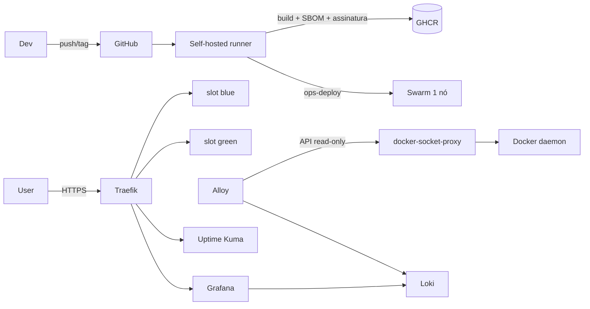

# Deploy Platform

Plataforma de deploy **blue-green**, health-gated, com rollback, observabilidade
e supply chain verificável para **um servidor Ubuntu**, sem Kubernetes e sem
serviço pago obrigatório.

O foco é operação real: uma imagem imutável só recebe tráfego depois de passar
no healthcheck; a rota do Traefik troca atomicamente; se a validação pública
falhar, a versão saudável continua no ar. O ledger registra quem implantou o
quê, com qual commit e configuração.

> **Status:** o fluxo está implementado e testado localmente. A execução no host
> real (SSH, DNS, Swarm, GHCR, runner e aceite) ainda é pendente. Veja
> [`docs/producao.md`](docs/producao.md) e [`docs/aceite.md`](docs/aceite.md).

## O que entrega

- **Blue-green com health gate**: dois slots, validação profunda, troca de rota
  e rollback automático em falha.
- **CLI operacional**: `deploy`, `rollback`, `verify`, `status` e `bootstrap`,
  com lock e ledger JSONL.
- **Edge seguro**: Traefik com ACME, TLS 1.2+, HSTS, headers, rate limit e
  dashboard com basic auth.
- **Observabilidade**: Loki + Alloy + Grafana para logs estruturados e Uptime
  Kuma para disponibilidade, independentes do ciclo de deploy.
- **Hardening**: containers read-only, `cap-drop`, limites
  de recursos; host com SSH por chave, UFW, auditd, fail2ban e atualizações.
- **Supply chain**: imagens por digest, actions por SHA, Gitleaks/Trivy/CodeQL,
  SBOM/proveniência e assinatura Cosign no fluxo de publicação.
- **Documentação operacional**: runbooks de deploy, rollback, incidente,
  recuperação, reconstrução e aceite.

## Arquitetura



Detalhes, fronteiras de confiança e decisões: [`docs/arquitetura.md`](docs/arquitetura.md)
e [`docs/adr/`](docs/adr/).

## Quickstart local

Requisitos: Docker Desktop com Linux containers, Git Bash/WSL e portas 80, 443
e 5000 livres.

```bash
cd local-demo
./scripts/up.sh
./scripts/demo.sh
```

No Windows, execute os comandos no Git Bash ou WSL.

O `up.sh` gera credenciais aleatórias em `local-demo/state/credentials.env`
(ignorado pelo Git), sobe a stack e faz o bootstrap do `demo-app`. O `demo.sh`
mostra deploy saudável, deploy recusado por dependência quebrada e rollback.
Para desligar sem apagar dados:

```bash
bash local-demo/scripts/down.sh
```

Detalhes e URLs: [`local-demo/README.md`](local-demo/README.md).

## Verificação

```bash
make check          # shellcheck, yamllint, actionlint, hadolint, Bats e Python
make security       # Trivy filesystem via Docker
make build          # imagem local do demo-app
```

O CI repete esses controles, faz smoke test da imagem e roda Gitleaks, Trivy,
CodeQL e Scorecard.

## Implantação no servidor

1. Inventário e acessos: [`docs/inventario.md`](docs/inventario.md),
   [`docs/acessos.md`](docs/acessos.md).
2. Base do host: `scripts/server/harden-system.sh`, `harden-ssh.sh`,
   `firewall.sh`, `install-docker.sh`, `init-swarm.sh`; runbook em
   [`runbooks/reconstrucao-servidor.md`](runbooks/reconstrucao-servidor.md).
3. Segredos, `.env` e instalação: `scripts/install.sh`.
4. Plataforma: `sudo ./scripts/bootstrap-platform.sh`.
5. Runner: `scripts/server/install-runner.sh`; runbook em
   [`runbooks/runner.md`](runbooks/runner.md).
6. Piloto: `ops-deploy bootstrap demo-app 1.0.0`; depois deploy pelo pipeline.
7. Observabilidade, segurança, drills e aceite: `docs/observabilidade.md`,
   `docs/seguranca.md`, `docs/aceite.md`.
8. Homologação em Ubuntu 24.04 e execução do aceite:
   [`runbooks/homologacao.md`](runbooks/homologacao.md).

## Estrutura

```text
scripts/ops-deploy             CLI de deploy/rollback/verify/status
scripts/install.sh             instala o pacote em /opt/deploy-platform
scripts/bootstrap-platform.sh  sobe proxy, monitoramento e logs
scripts/server/                hardening, Docker, Swarm, runner, backup e restore
deploy/apps/<app>/             app.conf por aplicação
deploy/traefik/                configuração estática e template de rotas
deploy/logging/                Loki, Alloy e datasource do Grafana
deploy/platform.yml            stack Swarm da plataforma
dynamic/                       rotas geradas (não versionadas)
apps/demo-app/                 aplicação piloto de referência
tests/                         testes Bats do CLI com dublês
runbooks/                      procedimentos operacionais
docs/                          arquitetura, ameaças, segurança, produção e aceite
local-demo/                    demonstração local do fluxo completo
```

## Segurança

- Nenhum valor real de senha/token no repositório; o demo gera credenciais
  aleatórias e o CI bloqueia segredos com Gitleaks.
- Alloy não monta o socket bruto do Docker; usa um proxy somente leitura em rede
  interna.
- Imagens de plataforma são fixadas por digest; ações do GitHub por SHA.
- O runner tem acesso equivalente a root via grupo `docker`. É um risco
  compensado por revisão, environment protegido e token efêmero, não eliminado.
- Relate vulnerabilidades em privado conforme [`SECURITY.md`](SECURITY.md).

## Limitações

- Um host: não há HA real de hardware/rede.
- Sem orquestração de migração de banco; rollback de aplicação pressupõe
  compatibilidade de dados.
- O demo local usa TLS self-signed e registry local; não é produção.
- O Traefik não gera `X-Request-ID`; sem cabeçalho de entrada, a correlação usa
  serviço + janela de tempo.
- A implantação real ainda precisa de DNS, credenciais, runner e aceite no host.

## Documentação

Índice completo em [`docs/index.md`](docs/index.md). Comece por:

- [`docs/producao.md`](docs/producao.md) — o que falta para go-live.
- [`docs/arquitetura.md`](docs/arquitetura.md) — desenho e fluxos.
- [`docs/ameacas.md`](docs/ameacas.md) — modelo de ameaças e riscos aceitos.
- [`docs/seguranca.md`](docs/seguranca.md) — controles e operação segura.
- [`docs/ops-deploy.md`](docs/ops-deploy.md) — CLI e `app.conf`.
- [`runbooks/`](runbooks/) — procedimentos do dia a dia.

## Licença

MIT. Veja [`LICENSE`](LICENSE).
