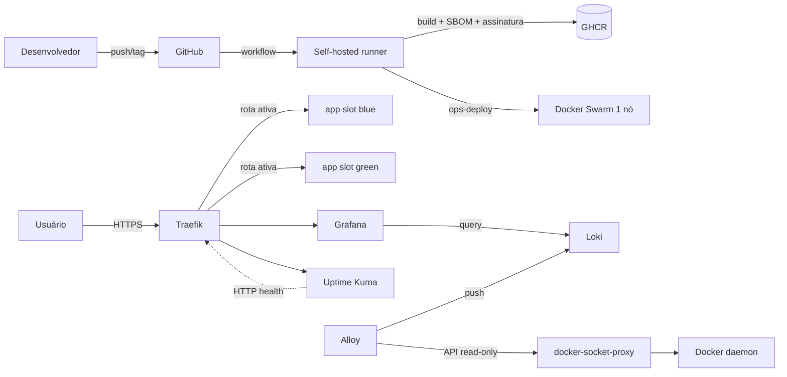

# Arquitetura

## Contexto

Plataforma de deploy para **um único servidor Ubuntu Server 24.04**, sem
Kubernetes e sem serviço pago obrigatório. O objetivo é entregar blue-green com
validação de saúde, rollback rápido, Observabilidade e supply chain verificável
com uma equipe pequena.

## Componentes

| Componente | Papel | Persistência |
|---|---|---|
| Traefik | TLS/ACME, roteamento, headers, rate limit | `traefik_letsencrypt` |
| `ops-deploy` | Deploy, rollback, verify, status, ledger | `/var/lib/ops-deploy` |
| Slots blue/green | Duas cópias do serviço da aplicação | volume da aplicação |
| Grafana | Consulta de logs | `grafana_data` |
| Loki | Armazenamento de logs | `loki_data` |
| Alloy | Coleta de logs via API Docker | `alloy_data` |
| Uptime Kuma | Disponibilidade e alertas | `uptime_data` |
| GHCR | Imagens imutáveis | externo |
| Runner | Executa CI/CD no host | `/opt/actions-runner` |

## Fluxo de deploy

1. O pipeline testa, escaneia segredos e constrói a imagem `app:<versao>`.
2. A imagem é publicada no GHCR com SBOM/proveniência; opcionalmente assinada.
3. `ops-deploy deploy <app> <versao>` baixa a imagem imutável.
4. O slot inativo é recriado com a configuração atual e limites de segurança.
5. O healthcheck profundo (`/health` + `status=healthy`) precisa passar.
6. A rota do Traefik é trocada atomicamente via arquivo em `dynamic/`.
7. O hostname público é validado; em falha, a rota anterior é restaurada e o
   slot novo é removido.
8. Após a janela de drenagem, o slot anterior é reduzido, salvo
   `APP_KEEP_PREVIOUS=1`.

O ledger `releases.jsonl` registra autor, commit, versão, slot, resultado e
checksum da configuração. A operação é serializada por um lock.

## Fluxo de rollback

`ops-deploy rollback <app> [versao]` reutiliza a imagem SemVer estável, recria o
slot de destino, valida saúde e troca a rota de volta. O rollback não desfaz
migração de dados: compatibilidade de schema é responsabilidade da aplicação.

## Limites de confiança

| Fronteira | Risco | Controle |
|---|---|---|
| Internet → Traefik | exposição, TLS fraco, abuso | TLS 1.2+, HSTS, rate limit, headers, portas internas fechadas |
| Traefik → serviços | acesso direto a dashboards | basic auth no dashboard, rede `public` controlada |
| Runner → host | runner comprometido executa como `deployer` (grupo docker) | PR revisado, environment `production`, token efêmero, permissões mínimas; risco residual aceito e documentado |
| Alloy → Docker | socket bruto equivale a root | socket proxy read-only em rede interna, capabilities mínimas |
| GitHub → imagem | tag mutável ou build adulterado | SemVer, digest, SBOM/proveniência, Cosign, Gitleaks/Trivy |
| Operador → segredos | vazamento em shell/histórico | Docker Secrets, `__FILE`, `.env` ignorado, rotação documentada |

## Falhas e comportamento

| Falha | Comportamento esperado |
|---|---|
| Imagem nova não sobe | deploy falha antes da troca de rota; slot saudável continua ativo |
| Healthcheck falha | rollback automático da rota; alerta no ledger/webhook |
| Traefik reinicia | rotas vêm do file provider; serviços continuam |
| Loki/Alloy indisponível | aplicação e deploy continuam; perda de logs durante a janela |
| Disco cheio | monitor de disco alerta; Loki tem retenção e compactor |
| Host reinicia | Swarm autolock exige desbloqueio; runbook de recuperação |
| Runner offline | deploy para; plataforma continua servindo |

## Decisões

- [ADR 0001: Swarm de nó único](adr/0001-swarm-no-unico.md)
- [ADR 0002: blue-green com file provider](adr/0002-blue-green-file-provider.md)
- [ADR 0003: socket proxy para o Docker](adr/0003-docker-socket-proxy.md)
- [ADR 0004: imagens imutáveis e supply chain](adr/0004-supply-chain.md)

## Limitações conhecidas

- Um host: não há alta disponibilidade real de hardware/rede.
- Sem orquestração de migração de banco; rollback de aplicação pode exigir
  compatibilidade de dados.
- O runner tem acesso equivalente a root via grupo `docker`; é um risco
  compensado, não eliminado.
- O Traefik não gera `X-Request-ID`; a correlação sem cabeçalho de entrada usa
  serviço + janela de tempo.
- O demo local usa TLS self-signed e registry local; não é produção.
